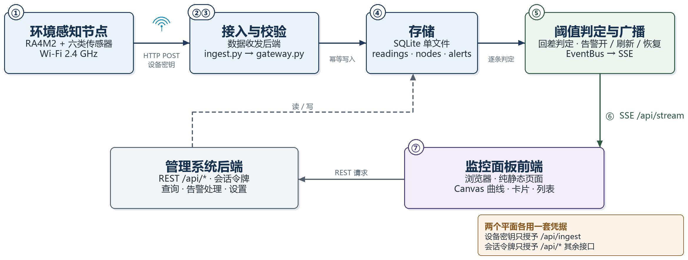
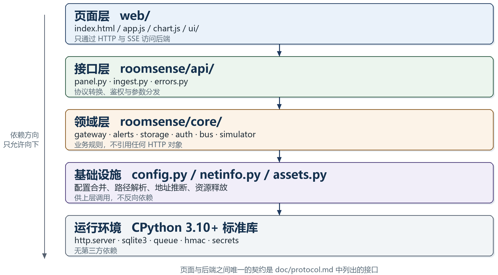
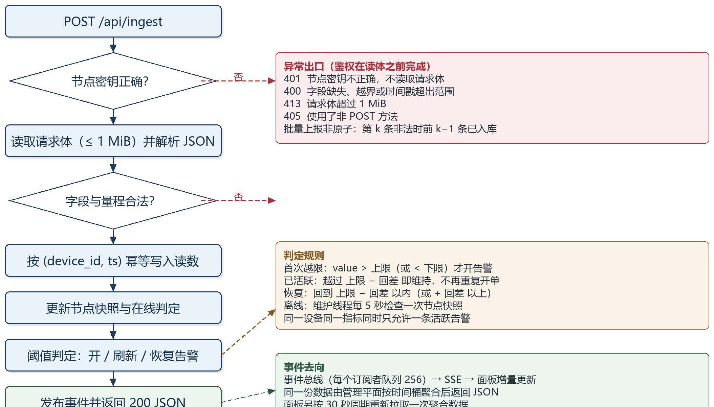
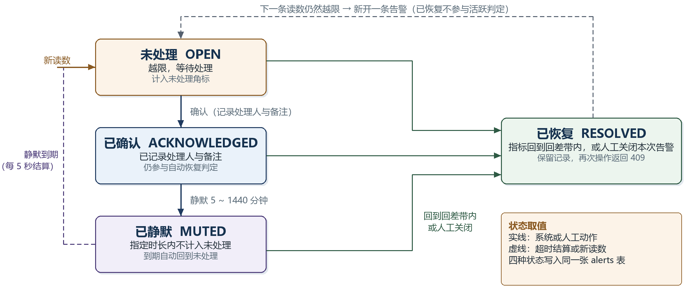

# RoomSenseBoard · 室内环境监控面板

## 系统设计文档

| 项目 | 内容 |
| --- | --- |
| 文档版本 | v1.0 |
| 编写日期 | 2026 年 11 月 |
| 软件版本 | RoomSenseBoard 0.3.1 |
| 技术栈 | Python 3.10+（标准库）、SQLite、原生 JavaScript 与 Canvas |
| 适用范围 | 系统方案、软件设计、界面设计、测试与部署 |

---

## 目 录

- [1 项目概述](#1-项目概述)
  - [1.1 需求分析](#11-需求分析)
  - [1.2 应用场景](#12-应用场景)
  - [1.3 主要技术指标](#13-主要技术指标)
- [2 总体方案](#2-总体方案)
  - [2.1 系统组成](#21-系统组成)
  - [2.2 数据流动方式](#22-数据流动方式)
  - [2.3 技术选型](#23-技术选型)
  - [2.4 可配置项](#24-可配置项)
- [3 软件设计](#3-软件设计)
  - [3.1 分层结构](#31-分层结构)
  - [3.2 启动与运行流程](#32-启动与运行流程)
  - [3.3 数据接入与校验](#33-数据接入与校验)
  - [3.4 告警判定与处理](#34-告警判定与处理)
  - [3.5 存储与查询](#35-存储与查询)
  - [3.6 实时推送](#36-实时推送)
  - [3.7 认证与会话](#37-认证与会话)
- [4 界面设计](#4-界面设计)
  - [4.1 页面结构](#41-页面结构)
  - [4.2 实时趋势图表](#42-实时趋势图表)
  - [4.3 告警处理交互](#43-告警处理交互)
  - [4.4 主题、响应式与可访问性](#44-主题响应式与可访问性)
  - [4.5 PWA 与离线](#45-pwa-与离线)
- [5 关键设计取舍](#5-关键设计取舍)
- [6 测试与验证](#6-测试与验证)
- [7 部署与配置](#7-部署与配置)
  - [7.1 部署方式](#71-部署方式)
  - [7.2 首次启动与账号](#72-首次启动与账号)
  - [7.3 节点接入配置](#73-节点接入配置)
- [8 局限性与后续工作](#8-局限性与后续工作)
- [附录 A  参数与容量](#附录-a--参数与容量)
- [附录 B  术语与缩略语](#附录-b--术语与缩略语)
- [附录 C  参考资料](#附录-c--参考资料)

---

## 1 项目概述

### 1.1 需求分析

室内环境的质量直接影响人员的健康、舒适与工作效率。CO₂ 浓度偏高会引起困倦与注意力下降，PM2.5 与噪声会损害呼吸系统与专注度，照度不足与温湿度偏离舒适区间同样会降低体感。要判断一间房间的通风是否充分、照明是否合适，单看某一时刻的读数没有意义，需要把多台节点、多项指标、连续多天的数据放进同一视图比较，并在越限时及时给出提示。

已有的做法通常有两类。一类是传感器自带的厂商云平台：数据封闭在厂商账户内，既无法与校内既有系统对接，也无法按需改造界面；另一类是自行编写的脚本加表格：数据能够留存，但缺少趋势图、告警与权限，更换一台机器就要重新搭建环境。两类做法都把采集与判读割裂开来——阈值写在固件里，改一次要重新烧录；数据出了问题只能翻日志，告警与处理过程也无从追溯。

本设计针对判读这一段展开：构建一套可独立部署的监控面板，接收环境感知节点上报的数据，完成校验、入库、阈值判定、告警处理与可视化，并把接入协议、接口与配置完整公开。设计目标如下：

- 零第三方依赖运行：一套可执行文件即可完成部署，不需要数据库服务、消息中间件或 Web 容器；
- 设备平面与管理平面分离：节点凭密钥上报，面板凭账号登录，两侧凭据互不影响，可分别轮换；
- 阈值、离线判定、数据保留与实时窗口在线可配，保存后立即生效，不需要重启服务；
- 告警可处理而不只是罗列：支持确认、静默与关闭，并记录处理人、处理时间与备注；
- 数据可追溯：任一指标都能查询 30 分钟至 30 天的历史曲线，并可导出为 CSV；
- 前后端解耦：页面为纯静态资源，既可以由后端同源提供，也可以单独部署到任意静态服务器。

### 1.2 应用场景

- 教室、自习室与图书馆：按座位区布设节点，在同一面板内对比不同位置的 CO₂ 与照度，为开窗、新风与照明调节提供依据；
- 办公室与会议室：用会议前后的 CO₂ 曲线判断通风是否充分，用噪声曲线判断讨论是否影响相邻工位；
- 机房、档案室与实验室：长期值守温湿度与粉尘，越限时在面板上给出告警，节点掉线单独判定；
- 多节点集中管理：所有节点按房间归组，面板提供跨节点的横向比较与统一的历史查询入口；
- 教学与二次开发：接入协议为 HTTP 与 JSON，接口清单与字段含义全部公开，任一请求都可用 curl 复现。

### 1.3 主要技术指标

系统的功能范围与性能边界汇总于表 1。

**表 1  主要技术指标**

| 项目 | 指标 / 说明 |
| --- | --- |
| 监测参数 | 温度、湿度、CO₂、PM2.5、噪声、光照，另含电量与信号强度 |
| 上报方式 | HTTP POST /api/ingest，JSON 正文，X-Device-Key 鉴权，单批最多 256 条 |
| 实时通道 | SSE（/api/stream），9 类事件，15 秒注释心跳，断线由浏览器自动重连 |
| 历史范围 | 30 分钟 / 1 小时 / 6 小时 / 24 小时 / 7 天 / 30 天，服务端按范围自动聚合 |
| 告警能力 | 7 类指标、2 个级别、4 种状态；支持确认、静默、关闭与自动恢复 |
| 并发规模 | 单进程；管理会话上限 32 个，SSE 连接每条占用一个工作线程 |
| 存储 | SQLite（WAL），默认保留 30 天，日志另限 2 万条 |
| 部署形态 | 单文件 exe（约 9 MB）或 python main.py，Python 3.10 及以上 |
| 客户端 | 现代浏览器；浅色 / 深色 / 跟随系统三档主题；可安装为 PWA |

## 2 总体方案

### 2.1 系统组成

系统由四部分组成，本设计覆盖其中前三部分：监控面板前端、数据收发后端与管理系统后端；环境感知节点作为数据来源，其设计见配套文档。

**表 2  系统组成**

| 部分 | 实现位置 | 职责 |
| --- | --- | --- |
| 监控面板前端 | web/ 下的静态页面 | 绘制实时曲线、节点、告警、历史与日志 |
| 数据收发后端 | api/ingest.py、core/gateway.py | 节点鉴权、上报校验、入库、阈值联动与事件广播 |
| 管理系统后端 | api/panel.py、core/auth.py | 静态资源、管理 REST、SSE 与账号会话 |
| 存储 | core/storage.py、data/roomsense.db | 节点快照、读数、告警、日志与运行设置 |
| 环境感知节点 | 独立固件工程 | 采集、换算与上报，见配套设计文档 |

后端在逻辑上分为两个平面。设备平面只提供 /api/ingest 一个入口，凭节点密钥鉴权；管理平面提供其余 /api/* 接口与 SSE，凭登录会话鉴权。两侧凭据分别保存在 data/device_key.txt 与 conf/accounts.json 中，轮换其一不影响另一侧。

### 2.2 数据流动方式

一次完整的数据流转包含采集、上报、校验、入库、判定、广播与呈现七个环节：

1. 节点按设定周期采集六项环境参数，换算为物理量后组装为 JSON 正文，经 Wi-Fi 以 HTTP POST 发往 /api/ingest；
2. 数据收发后端比对请求头中的节点密钥（X-Device-Key 或 Authorization: Bearer），不一致立即返回 401，不读取请求体；
3. 校验通过的报文进入网关并逐条归一化：设备号按字符集与长度校验，时间戳限定为不早于 24 小时、不晚于 5 分钟，各指标按物理量程校验，且至少包含一项主指标；
4. 读数写入 readings 表；同一设备同一秒的重复上报只覆盖非空字段，随后更新 nodes 表中的最新值与累计条数；
5. 阈值判定对每条读数执行：越过阈值即开告警，已活跃的告警只刷新数值与消息，回到回差带内则自动恢复；
6. 入库结果、告警变化与节点状态被投递到进程内事件总线，由 SSE 通道推送给所有在线面板；
7. 前端收到事件后增量更新对应视图；未收到事件的页面按 30 秒周期重新拉取聚合数据。

*图 1  系统组成与数据流向*

反向链路同样存在：面板的查询、告警处理与设置保存都以 REST 请求发往管理平面，服务端校验会话与参数后读写数据库，并把变化广播给其他已打开的客户端。时间基准由服务端下发：登录与每次接口响应都带 server_time，前端据此维护一个时钟偏移量，使曲线横轴不依赖浏览器所在机器的系统时间。

### 2.3 技术选型

各环节的技术选择与需要接受的代价列于表 3。选型的共同取向是减少部署依赖：能在标准库内解决的，不引入第三方包；能用单文件存储的，不引入独立数据库服务。

**表 3  技术选型**

| 环节 | 选择 | 依据 | 代价与限制 |
| --- | --- | --- | --- |
| 运行环境 | CPython 3.10+，仅标准库 | 现场无需安装依赖，也便于打包为单文件 | 没有异步框架，并发由线程模型决定 |
| HTTP 服务 | 标准库 ThreadingHTTPServer | 一个连接一个线程，SSE 长连接可直接占用线程 | 无连接数上限与读超时 |
| 存储 | SQLite，WAL 模式 | 单文件、事务完整、支持 SQL 聚合，备份即复制文件 | 单写者，写入经进程内锁串行化 |
| 实时推送 | SSE（Server-Sent Events） | 浏览器原生支持、断线自动重连，服务端只需写文本帧 | 单向推送，每条连接占用一个线程 |
| 前端 | 原生 JavaScript 与 Canvas | 无需构建工具，静态托管即可，包体小、启动快 | 图表、控件与状态管理均需手写 |
| 告警 | 服务端按阈值与回差判定 | 规则集中管理，调整阈值不需要改固件 | 只支持单指标阈值，不支持跨指标组合条件 |
| 部署 | PyInstaller 单文件打包 | 双击即可运行，首次运行自动释放页面与配置 | 启动需解包，体积约 9 MB |

### 2.4 可配置项

配置分三层，优先级由高到低为：命令行参数、conf/config.json、数据库中的运行设置。环境变量可覆盖监听地址、端口与日志级别等少量项。三层合并后，运行设置在启动时读入内存，面板保存时立即生效并写入数据库，因此不需要重启服务。

**表 4  可配置项**

| 配置项 | 位置 | 默认值 | 作用 |
| --- | --- | --- | --- |
| server.host / server.port | 配置文件、命令行 | 127.0.0.1:20500（打包后 0.0.0.0） | 监听地址与端口；被占用时自动顺延 |
| server.public_url | 设置页或配置文件 | 空（自动推断） | 节点与外部访问使用的地址 |
| server.session_hours | 配置文件 | 12 | 登录会话有效期 |
| server.cors_origins | 配置文件 | 空 | 前后端分离部署时的来源白名单 |
| storage.retention_days | 设置页 | 30（1–365） | 读数、日志与已恢复告警的保留天数 |
| storage.live_window_minutes | 设置页 | 25（5–120） | 实时趋势的时间窗长度 |
| device.offline_timeout | 设置页 | 90 秒（15–3600） | 超过该时长未上报即判定离线并告警 |
| device.max_batch | 配置文件 | 256 | 批量上报的单批上限 |
| alerts.* 的 low / high / critical_* | 设置页 | 见 3.4 节 | 各指标的警告与严重阈值 |
| alerts.*.hysteresis | 配置文件 | 见 3.4 节 | 回差，只在配置文件中维护 |
| logging.console_level | 配置文件或环境变量 | INFO | 终端日志级别，OFF 关闭 |
| simulator.enable | 命令行或环境变量 | 关闭 | 是否启动内置模拟节点 |

环境变量共六个：ROOMSENSE_HOST、ROOMSENSE_PORT、ROOMSENSE_SIMULATE、ROOMSENSE_LOG_LEVEL、ROOMSENSE_ADMIN_USER、ROOMSENSE_ADMIN_PASSWORD。其中后两个只在首次创建账号时生效。

## 3 软件设计

### 3.1 分层结构

代码按依赖只能向下的原则分层：页面层只通过 HTTP 与 SSE 访问后端；接口层只做协议转换、鉴权与参数分发；领域层承载业务规则；基础设施层提供配置、路径与地址推断；最底层是标准库。依赖方向可直接从各模块的 import 语句读出。

*图 2  软件分层结构*

- 接口层（roomsense/api/）不含业务判断，校验失败统一抛出 ApiError，由一处转换为状态码与 JSON 响应；
- 领域层（roomsense/core/）不引用任何 HTTP 对象，网关只接收字典，因此同一套逻辑可被 HTTP、模拟器与测试直接调用；
- storage.py 是唯一直接书写 SQL 的模块，其余模块只调用它暴露的方法；
- 配置、路径与对外地址推断集中在 config.py 与 netinfo.py，其他模块不自行读取环境变量；
- 页面与后端之间唯一的契约是 doc/protocol.md 列出的接口，替换页面实现不影响后端。

**表 5  模块与职责**

| 模块 | 职责 |
| --- | --- |
| main.py | 解析命令行、释放资源、绑定端口、打印启动横幅、进入服务循环 |
| api/panel.py | 静态资源、管理 REST、SSE、CORS 与统一错误响应 |
| api/ingest.py | 设备上报入口与密钥校验 |
| core/gateway.py | 上报校验、入库、告警联动、离线检测与设置合并 |
| core/alerts.py | 阈值与回差判定，给出需要新开或解除的告警 |
| core/storage.py | 表结构、全部 SQL、迁移与按保留期清理 |
| core/auth.py | 账号文件、会话与登录限速 |
| core/bus.py | 进程内事件总线与有界订阅队列 |
| core/simulator.py | 无硬件阶段的数据模拟 |
| config.py / netinfo.py / assets.py | 默认配置与合并、对外地址推断、打包资源释放 |

### 3.2 启动与运行流程

启动过程分为五步，任一步失败都会在终端给出可读的原因并退出：

1. 资源准备：打包运行时，程序把 web/、doc/、README.md 等只读资源释放到可执行文件旁边，并以 data/assets.json 记录版本与文件哈希；升级时只刷新上次由程序写入、之后未被修改的文件；
2. 配置装配：读取默认配置，叠加 conf/config.json、环境变量与命令行参数，再与数据库中的运行设置合并；账号、节点密钥与数据库连接在这一步就绪；
3. 端口绑定：从配置端口开始尝试，被占用时依次顺延，最多尝试 11 次；绑定成功后回读实际端口；
4. 地址解析：按配置、监听地址、公网出口与本机网卡的顺序确定对外访问地址，分别给出面板地址与上报地址；两者可能并不相同；
5. 进入服务：启动维护线程，打印启动横幅（面板地址、账号、初始密码、上报地址、模拟器状态），随后进入请求循环。

运行期共三类线程。主线程负责请求分发，每个 TCP 连接派生一个工作线程，SSE 连接长期占用其中一个；维护线程每 5 秒检查离线节点并结算到期的静默告警，每 3600 秒执行一次数据清理；模拟线程仅在启用模拟器时存在，按固定间隔生成读数，并与真实节点走完全相同的校验与入库路径。各周期任务的时间参数见表 6。

**表 6  周期任务与时间参数**

| 任务 | 周期 | 说明 |
| --- | --- | --- |
| 离线判定 | 5 秒 | 超过 offline_timeout 未上报的节点开 device_offline 告警 |
| 静默结算 | 5 秒 | muted_until 到期的告警回到未处理 |
| 数据清理 | 3600 秒 | 删除超过保留期的读数、已恢复告警与日志 |
| SSE 心跳 | 15 秒 | 无事件时发送注释帧，避免中间代理断开连接 |
| 前端轮询 | 30 秒 | 仪表盘重新拉取聚合数据，其余页面仅保活会话 |
| 前端时间轴 | 1 秒 | 推进图表时间域，不请求数据 |
| 端口顺延 | 最多 10 次 | 端口被占用时依次尝试下一个端口 |

### 3.3 数据接入与校验

设备上报走单一入口，处理顺序固定为：路径匹配、方法校验、密钥校验、请求体读取、字段归一化。密钥校验在读体之前完成，因此错误密钥不会消耗带宽，也不会进入后续处理环节。完整流程见图 3。

*图 3  上报与请求处理流程*

**表 7  上报字段与校验规则**

| 字段 | 必填 | 规则 |
| --- | --- | --- |
| device_id | 是 | 1–64 位，首字符为字母或数字，其余允许字母、数字与 _ . : - |
| ts | 否 | Unix 秒；晚于服务端 5 分钟按服务端时间处理，早于 24 小时拒绝 |
| temperature | 五项至少一项 | −40 ~ 125 °C |
| humidity | 同上 | 0 ~ 100 %RH |
| co2 | 同上 | 0 ~ 20000 ppm |
| pm25 | 同上 | 0 ~ 1000 µg/m³ |
| noise | 同上 | 0 ~ 140 dB |
| light | 否 | 0 ~ 200000 lx |
| battery | 否 | 0 ~ 15 V |
| rssi | 否 | −150 ~ 0 dBm |
| seq | 否 | 整数，用于排查丢包与重复 |
| name / room | 否 | 64 字以内，首次上报时写入，之后可在面板修改 |

写入采用幂等设计：readings 表以 (device_id, ts) 建立唯一约束，同一秒的重复上报只覆盖非空字段，因此节点重发不会产生重复曲线；节点快照只在时间戳不早于 last_seen 时更新，断网期间缓存后补传的旧数据不会把最近一次读数改回过去。批量上报单批上限 256 条，整批共用同一服务端时间，但逐条校验、逐条提交：第 k 条不合法时前 k−1 条已经入库，接口返回 400 并在 error 字段说明原因。这一取舍换来了实现简单与重试安全——节点按 (device_id, ts) 重发不会产生副作用。

### 3.4 告警判定与处理

告警由服务端按读数逐条判定，规则集中保存在运行设置中，面板修改后立即生效。判定分两级：越过警告阈值记为 warning，越过严重阈值记为 critical。同一设备同一指标同时最多存在一条活跃告警，持续越限只刷新数值与消息，不会重复开单。默认阈值见表 8。

**表 8  告警阈值与回差**

| 指标 | 方向 | 警告阈值 | 严重阈值 | 回差 |
| --- | --- | --- | --- | --- |
| 温度 | 上限 / 下限 | 28 / 18 °C | 32 / 12 °C | 0.5 |
| 湿度 | 上限 / 下限 | 70 / 30 %RH | 85 / 20 %RH | 2 |
| CO₂ | 上限 | 1000 ppm | 1500 ppm | 50 |
| PM2.5 | 上限 | 75 µg/m³ | 150 µg/m³ | 10 |
| 噪声 | 上限 | 70 dB | 85 dB | 5 |
| 光照 | 下限 | 80 lx | 30 lx | 15 |
| 电量 | 下限 | 3.5 V | 3.3 V | 0.05 |

回差用于抑制阈值附近的抖动。对上限而言：尚未活跃时，数值严格大于阈值才开告警；一旦活跃，只要数值仍大于阈值减去回差就维持，回落到该边界以内才恢复。下限与之对称：尚未活跃时数值严格小于阈值才开告警，活跃后回差带内的波动不会引起状态变化。因此告警不会在阈值附近来回切换，而是要回退一个回差带才算恢复。

除指标告警外，还有一类与数值无关的离线告警：维护线程每 5 秒检查一次节点快照，对超过 offline_timeout 未上报且此前有过读数的节点开一条 device_offline 告警；该节点下一次上报被受理时自动恢复。从未上报过数据的新设备不产生离线告警，避免设备在部署前反复告警。

*图 4  告警状态机*

告警实例有四种状态：未处理、已确认、已静默、已恢复。前三者统称活跃告警，参与角标统计与自动恢复判定；已恢复的告警保留在库中供追溯，对已恢复告警再次处理会返回 409。确认会记录处理人与备注，并使其不再计入未处理数量；静默在指定时长内不计入未处理，到期后自动回到未处理；关闭本次告警会结束该实例，如果越限仍然持续，下一条读数会重新开一条新告警。确认与关闭的区别在于前者只是知悉，后者是结束本次实例。

**表 9  告警处理动作**

| 动作 | 前置状态 | 结果 | 记录内容 |
| --- | --- | --- | --- |
| 确认 | 未处理 / 已静默 | 转为已确认，不再计入未处理 | 处理人、处理时间、备注 |
| 静默 | 未处理 / 已确认 | 转为已静默，到期自动回到未处理 | 处理人、静默截止时间、备注 |
| 关闭 | 任意活跃状态 | 转为已恢复，结束本次实例 | 关闭人、关闭时间、备注 |
| 自动恢复 | 任意活跃状态 | 转为已恢复，消息改为已回落或已回升 | 恢复时间 |
| 批量确认 | 未处理 | 全部转为已确认 | 操作人 |

重复确认不会覆盖第一次的处理人与备注，只补充备注；备注长度上限 200 字，超出部分截断。所有处理动作都会写一条日志并广播给其他在线面板，因此同一告警在不同终端上的状态保持一致。

### 3.5 存储与查询

存储使用 SQLite 单文件数据库，开启 WAL 日志模式，读操作不阻塞写入。所有访问经同一把可重入锁串行化，连接以 check_same_thread=False 创建，避免每个工作线程各开一个连接带来的锁竞争。

**表 10  数据表**

| 表 | 内容 | 关键约束 |
| --- | --- | --- |
| nodes | 节点名称、位置、首次与最近上报时间、最新快照 | device_id 主键 |
| readings | 每一条上报读数及信号强度、序号 | UNIQUE(device_id, ts)；按 (device_id, ts) 与 ts 建索引 |
| alerts | 告警实例、级别、阈值、处理人与备注 | 按 (device_id, kind, state) 与 (state, opened_at) 建索引 |
| logs | 运行日志，七个级别 | 按 ts 建索引 |
| settings | 运行设置，整体存为一行 JSON | key 主键 |

历史曲线不做逐点传输：服务端按查询范围把读数归入固定宽度的时间桶，返回每桶的平均值，温度与湿度额外给出桶内最小值与最大值。范围与桶宽一一对应，保证任一范围的点数都在数百量级，前端无需分页即可完整绘制。

**表 11  历史范围与聚合粒度**

| 范围 | 窗口长度 | 聚合桶宽 | 单节点点数（约） |
| --- | --- | --- | --- |
| 30 分钟 | 1800 秒 | 30 秒 | 60 |
| 1 小时 | 3600 秒 | 60 秒 | 60 |
| 6 小时 | 21600 秒 | 300 秒 | 72 |
| 24 小时 | 86400 秒 | 900 秒 | 96 |
| 7 天 | 604800 秒 | 3600 秒 | 168 |
| 30 天 | 2592000 秒 | 14400 秒 | 180 |

清理任务每小时执行一次：删除超过保留期的读数、已恢复且超过保留期的告警，以及超过保留期的日志；日志另外限制在 2 万条以内，避免长期运行后无限增长。节点删除提供两种语义：保留历史时只移除节点并关闭其活跃告警，历史读数仍可按设备号查询；连同清理时一并删除该节点的读数与告警。

### 3.6 实时推送

实时通道采用 SSE，路径为 /api/stream，令牌通过查询参数携带，因为浏览器的 EventSource 不支持自定义请求头。服务端在建立连接后先发送一条 hello 事件，随后按事件类型推送；空闲时每 15 秒发送一次注释帧，避免中间代理因超时断开。事件类型见表 12。

**表 12  SSE 事件**

| 事件 | 触发时机 | 主要载荷 |
| --- | --- | --- |
| hello | 连接建立 | 版本、运行时长、节点与读数统计 |
| reading | 每条读数入库后 | 设备号、时间戳、七项指标、信号强度 |
| alert | 开、刷新、静默、恢复与到期 | 告警对象，含状态、处理人与备注 |
| node | 节点上线、离线或信息变更 | 节点快照与在线状态 |
| node_deleted | 节点被删除 | 删除条数与保留条数 |
| log | 产生日志 | 时间、级别、来源与内容 |
| settings | 设置保存后 | 完整运行设置 |
| alerts_ack | 批量确认后 | 确认条数 |
| device_key | 密钥轮换后 | 轮换标记 |

每个订阅者持有一个容量 256 的有界队列。发布者只做非阻塞投递：队列满时丢弃最旧的事件再放入新的，因此慢客户端不会阻塞采集线程，代价是该连接会丢失少量中间事件——下一次全量拉取会补齐状态，实时曲线本身也会按时间重新排序。

前端对事件的处理原则是增量更新、按需全量：reading 事件直接插入本地序列并重绘对应图表；alert 与 node 事件更新列表，并在 800 毫秒去抖后重新拉取聚合数据；settings 事件触发整页配置重载。断线由浏览器自动重连，连续两次失败后前端调用一次会话校验，会话失效则回到登录页。

### 3.7 认证与会话

两个平面使用彼此独立的凭据，互不授予对方权限，见表 13。

**表 13  两个平面的鉴权**

| 平面 | 入口 | 凭据 | 存放与生命周期 |
| --- | --- | --- | --- |
| 设备平面 | POST /api/ingest | 节点密钥（X-Device-Key 或 Bearer） | data/device_key.txt，32 字符；可在面板轮换，轮换后旧密钥立即失效 |
| 管理平面 | /api/* 其余接口与 SSE | 会话令牌（X-Auth-Token 或 ?token=） | 服务端内存，默认 12 小时滑动过期，服务重启即失效 |
| 登录 | POST /api/login | 账号与口令 | conf/accounts.json；首次启动生成随机初始口令 |

登录失败按来源地址限速：5 分钟内失败 10 次后返回 429。账号不存在与口令错误返回同一提示，账号不存在时也执行一次等长比较，避免通过响应时间判断账号是否存在。口令按项目约定以明文保存在 conf/accounts.json 中，便于查看与找回；文件权限设为 0600，且不应提交到版本库。历史版本留下的 PBKDF2 摘要仍可登录，登录成功后自动迁移为明文。

会话令牌保存在服务端内存中，最多 32 个，超出时淘汰最久未使用的一个。修改口令会立即使该账号的其他会话失效，当前会话保留。忘记口令时可执行 --reset-password 生成新的随机口令并打印；该命令只操作与可执行文件同目录的账号文件，不启动服务。

## 4 界面设计

### 4.1 页面结构

面板采用侧栏加页面的单页结构：左侧为品牌、导航与在线、告警摘要，右侧为页面标题、连接状态与内容区。登录页、主框架与内容区互斥显示，未登录时只渲染登录卡片。六个页面的内容见表 14。

**表 14  页面与内容**

| 页面 | 主要内容 |
| --- | --- |
| 仪表盘 | 四张环形卡片（在线节点、平均温度、平均湿度、未处理告警）、实时趋势、环境概览、节点状态表、最近告警与运行状态 |
| 节点 | 全部节点的实时读数与累计上报次数，可搜索、改名、改位置，或删除节点并选择是否清理历史 |
| 告警 | 按状态筛选的告警卡片，含级别、设备、触发与恢复时间、处理人与备注，可确认、静默、关闭 |
| 历史数据 | 按节点与指标查询六档范围，显示最小值、平均值、最大值与最新值，可导出 CSV |
| 日志 | 按级别筛选的服务日志，实时滚动，可取消自动跟随以翻阅历史 |
| 设置 | 告警阈值、运行参数、对外访问地址、设备接入、账号安全与关于 |

节点详情、告警处理与删除确认以模态对话框呈现，均支持 Esc 关闭并限制焦点范围。页面切换不使用 URL 路由，当前页记录在会话存储中，刷新后回到原来的页面。

### 4.2 实时趋势图表

实时趋势是面板的核心视图。每个指标各自一张小图、各自一条纵轴，可按需多选同时显示，因此温度与 CO₂ 这类量纲差别很大的曲线不会互相挤压。

横轴采用先增长、后滑动的策略：节点刚开始上报时，左边界固定为首条数据的时刻，曲线自左向右生长；累计时长达到窗口长度后，左边界开始跟随右边界移动，横轴始终显示最近 N 分钟。窗口长度取自运行设置，默认 25 分钟，可在 5 至 120 分钟之间调整。图中虚线为该指标的告警阈值，便于与曲线逐点对照。

绘制使用 Canvas，先按设备像素比放大画布，再以 CSS 像素坐标系作图，因此在高分屏上线条不发虚；纵轴刻度按 1、2、2.5、5 的步长取整，时间标签按跨度自动切换为秒、分或日期；相邻点的时间差超过阈值时断开曲线，避免把断网期间的空档连成一条直线。重绘由 requestAnimationFrame 合并，同一帧内的多次数据更新只绘制一次。

指针交互使用 Pointer Events：移动时按时间轴反查最近的数据点，显示一条吸附到数据点的十字线与浮层，浮层列出该时刻所有可见指标的值。触摸设备上图表允许纵向滚动，横向拖动用于查看曲线，不会阻断页面滚动。

### 4.3 告警处理交互

告警页以卡片而非表格呈现，原因是一条告警需要同时展示设备、房间、级别、触发时间、恢复时间、静默截止时间、处理人与备注，这些字段在窄屏表格中无法容纳。

- 筛选分为活跃、未处理、已确认、已静默、已恢复与全部六档，默认显示活跃；
- 顶部汇总条给出各状态与各级别的条数，侧栏导航上的角标只统计未处理，超过 99 显示为 99+；
- 处理弹窗提供备注输入与静默时长选择，确认、静默与关闭三个动作共用同一个弹窗，提交后并行刷新列表与概览；
- 批量确认只作用于未处理告警，执行后以提示条给出条数；
- 告警被其他终端处理后，当前面板通过 alert 事件同步状态，不需要手动刷新。

### 4.4 主题、响应式与可访问性

外观支持浅色、深色与跟随系统三档，选择保存在浏览器本地。主题在页面头部同步应用，避免首屏闪白；切换时通过自定义事件通知图表按新配色重绘。颜色全部以 CSS 变量定义，七个指标各有固定色相，深浅两套主题共用同一套语义色。

布局按五档断点调整：1100 像素以下卡片改为两列、主区域拆为单列；800 像素以下侧栏移到顶部，成为可横向滚动的导航条；720 像素以下表格卡片化，表头隐藏、每个单元格前显示字段名；600 像素以下弹窗全屏、输入框字号提到 16 像素以避免移动端聚焦时页面缩放；480 像素以下进一步压缩间距与环形仪表尺寸。

语义与键盘支持尽量依托原生控件：对话框使用 dialog 元素获得焦点陷阱与 Esc 关闭；趋势指标条使用 aria-pressed 表示选中状态；告警汇总、日志输出与连接状态分别标注 role；下拉选择器因原生弹出层无法跟随主题而自绘，但保留 combobox 与 listbox 语义、方向键与首字母定位，未执行脚本时回退为原生控件。系统开启减少动态效果时，环形仪表与按钮的过渡被取消。

### 4.5 PWA 与离线

页面提供 manifest 与 Service Worker，在 HTTPS 或本机回环地址下可安装到桌面或主屏幕。安装后以独立窗口打开，图标、主题色与启动地址由 manifest 指定。

Service Worker 预缓存页面骨架、样式、脚本与图标，请求按三类分流：/api/* 与服务脚本本身不缓存；导航请求走网络，失败时回退到缓存的页面骨架；其余同源静态资源走缓存优先，命中后直接返回。缓存名带有版本号，发布新版本时需要同步更新，否则浏览器会继续使用旧资源。由于 /api/* 始终走网络，离线时页面可以打开，但实时数据仍需后端在线。

## 5 关键设计取舍

方案中若干处需要在实现复杂度、运行开销与使用体验之间取舍，主要几项见表 15。

**表 15  关键设计取舍**

| 取舍点 | 选择 | 理由 | 代价 |
| --- | --- | --- | --- |
| 实时通道 | SSE 而非 WebSocket | 只需服务端单向推送，浏览器原生重连，服务端写入文本帧即可 | 每条连接占用一个线程，无法承载二进制 |
| 存储 | SQLite 而非独立数据库 | 部署即复制，零运维，SQL 聚合足够本场景 | 单写者，写入经进程内锁串行 |
| 并发模型 | 每连接一线程 | 与标准库 HTTP 服务器一致，SSE 实现最简单 | 无连接上限与读超时，慢连接会占用线程 |
| 上报校验 | 逐条校验、逐条提交 | 实现简单，配合唯一约束可安全重试 | 批量中第 k 条非法时前 k−1 条已入库 |
| 告警状态 | 四态并保留已恢复记录 | 可追溯处理过程，区分已处理与已恢复 | 表随运行时间增长，需要按保留期清理 |
| 口令存储 | 明文（项目约定） | 便于查看与找回，适合教学与内网场景 | 能读到账号文件即等于拿到全部口令 |
| 实时窗口 | 先增长后滑动 | 新节点不必等窗口填满即可看到曲线 | 窗口未满时横轴刻度较密 |
| 历史曲线 | 服务端时间桶聚合 | 传输量与点数可控，前端无需分页 | 尖峰被平均化，仅温湿度保留桶内极值 |

## 6 测试与验证

系统交付前按表 16 逐项验证，表中同时给出各项的判定标准。后端另有一套单元测试，覆盖存储与迁移、阈值与回差、网关校验、账号与会话、模拟器、配置合并、HTTP 接口、地址推断、PWA 资源与打包资源释放，随打包脚本在构建前自动执行。

**表 16  验证项目与判定标准**

| 验证项 | 方法 | 判定标准 |
| --- | --- | --- |
| 登录与会话 | 错误口令连续尝试、修改口令、重启服务 | 错误口令返回 401 并触发限速；改密后其他会话失效；重启后需重新登录 |
| 节点鉴权 | 不带密钥、错误密钥、Bearer 方式上报 | 前两者返回 401，Bearer 方式正常受理 |
| 上报校验 | 构造越界值、缺少主指标、超大请求体 | 分别返回 400 与 413，错误信息指出具体字段 |
| 幂等与补传 | 同一时间戳重复上报；补传早于 last_seen 的数据 | 曲线不出现重复点，节点快照不被回退 |
| 告警触发 | 用模拟器制造高温、高 CO₂ 与节点离线 | 告警按阈值与回差开、刷新、恢复，级别正确 |
| 告警处理 | 确认、静默到期、关闭后继续越限 | 状态与处理人正确；静默到期回到未处理；关闭后重新开一条 |
| 离线判定 | 停止模拟节点上报超过离线阈值 | 5 秒内开出离线告警，恢复上报后自动关闭 |
| 实时推送 | 多浏览器同时打开面板，断开网络再恢复 | 各端数值一致，断线自动重连并补齐状态 |
| 历史与导出 | 六档范围查询并导出 CSV | 点数与桶宽相符，CSV 列完整、可被表格软件打开 |
| 打包部署 | 在临时目录运行打包产物 | 首次运行释放资源，面板可访问，默认不启用模拟器 |

## 7 部署与配置

### 7.1 部署方式

部署有三种形态，按现场条件选择：

- 源码运行：执行 python main.py，默认只监听 127.0.0.1:20500；加 --host 0.0.0.0 可供同网段访问；
- 单文件运行：打包后的 exe 默认监听 0.0.0.0，首次运行在自身旁边释放 conf/、data/、web/ 与文档；升级时替换 exe 即可，改过的页面与配置保留；
- 前后端分离：页面部署到任意静态服务器，修改 web/config.js 指向后端地址，并把面板来源登记到 server.cors_origins。

公网部署建议在前端加反向代理并启用 HTTPS：面板默认使用明文 HTTP，登录口令与会话令牌在公网可被嗅探；PWA 安装同样要求 HTTPS 或本机地址。代理需要放行 SSE——服务端已返回 X-Accel-Buffering 头，代理侧也应关闭对 text/event-stream 的响应缓冲，并把 /api/* 透传到后端。

### 7.2 首次启动与账号

首次启动会创建管理账号并在终端打印一次初始密码，同时给出面板地址、上报地址与账号文件位置。登录后应在设置的账号安全页修改口令。忘记口令时可执行 --reset-password admin（打包后为 RoomSenseBoard.exe --reset-password admin），命令会生成新的随机口令并打印账号文件路径。

### 7.3 节点接入配置

节点侧需要三项配置：上报地址、节点密钥与设备号。上报地址在设置的设备接入页查看，可用使用当前访问地址直接取浏览器地址栏；节点密钥保存在 data/device_key.txt，可在同一页面轮换，轮换后旧密钥立即失效，所有节点需同步更新。设备号建议采用房间标识加编号的形式，首次上报后可在面板改名与改位置。

## 8 局限性与后续工作

- 单进程部署：单栋楼宇规模足够，跨楼宇或数百节点的场景需要把采集与展示拆分；
- 每连接一线程且无读超时：长连接与慢连接会占用线程，公网暴露时应限制来源或置于反向代理之后；
- 口令明文保存：便于查看与找回，但读取账号文件即等于拿到全部口令；面板默认使用明文 HTTP，未内建 TLS；
- 告警规则只支持单指标阈值与回差，暂不支持跨指标组合条件与持续时长条件；
- 历史聚合为桶平均值，短时尖峰会被平均化，仅温度与湿度保留桶内极值；
- 前端没有 URL 路由，页面状态不能通过链接分享；图表没有键盘操作与数据表替代，读屏软件无法获取曲线内容；
- 后续可扩展的方向包括：MQTT 接入、TLS 与账号角色、告警通知（邮件与 Webhook）、跨设备聚合视图、按房间分组的权限，以及读数导出为列式存储格式。

## 附录 A  参数与容量

**表 17  主要参数与容量**

| 参数 | 值 | 说明 |
| --- | --- | --- |
| 上报间隔建议 | 5 ~ 30 秒 | 由节点侧决定，面板不做限流 |
| 单批上报上限 | 256 条 | device.max_batch |
| 请求体上限 | 1 MiB | 超过返回 413 |
| 实时读数上限 | 每次 5000 点 | /api/live，超出保留最新 |
| 节点详情上限 | 每次 2000 点 | /api/nodes/<id> 的实时窗口 |
| 前端实时序列 | 每设备 3000 点 | 超出后裁掉最旧的读数 |
| 历史点数 | 每节点约 60 ~ 180 点 | 由查询范围与聚合桶宽决定 |
| 管理会话上限 | 32 个 | 超出时淘汰最久未使用的会话 |
| 会话有效期 | 12 小时 | 滑动续期，每次请求刷新 |
| 登录限速 | 每 IP 5 分钟 10 次 | 超出返回 429 |
| 日志保留 | 2 万条或保留期内 | 先到者生效 |
| 数据库容量 | 约 260 万行 / 30 天 | 按 5 个节点、5 秒一条估算，可随保留期裁剪 |

## 附录 B  术语与缩略语

**表 18  术语与缩略语**

| 术语 | 含义 |
| --- | --- |
| SSE（Server-Sent Events） | 服务器向浏览器单向推送事件的 HTTP 长连接，浏览器原生支持断线重连 |
| REST | 以 HTTP 方法与资源路径表达操作的接口风格，本项目用于管理平面的查询与设置 |
| JSON / CSV | 前者是上报与接口正文的格式，后者是历史数据的导出格式 |
| SQLite / WAL | 嵌入式单文件数据库；WAL 为预写日志模式，读写互不阻塞 |
| 会话令牌 | 登录后由服务端签发的一次性凭据，随请求头携带，由服务端内存校验 |
| 节点密钥 | 设备平面使用的共享密钥，随上报请求头携带，可在面板轮换 |
| 回差（hysteresis） | 阈值附近的缓冲带，用于避免读数抖动导致告警反复开闭 |
| 时间桶 | 把连续读数按固定宽度归并成一段，用该段的平均值代表这段时间 |
| PWA | 可安装到桌面或主屏幕的网页应用，由 manifest 与 Service Worker 支持 |
| CORS | 跨源资源共享；前后端分离部署时由服务端按白名单回显请求来源 |
| 守护线程 | 随主进程退出而终止的后台线程，本项目的维护任务运行在其中 |

## 附录 C  参考资料

- 《HTTP Semantics》RFC 9110，IETF：请求方法、状态码与头部语义；
- 《Server-Sent Events》，W3C Recommendation：事件流格式、注释帧与重连行为；
- 《SQLite Documentation》：WAL 模式、PRAGMA 设置与聚合函数；
- 《Python 标准库文档》：http.server、socketserver、sqlite3、queue 与 argparse；
- 《PyInstaller Manual》：单文件模式、资源收集与版本信息；
- 《Web App Manifest》与《Service Worker》，W3C：PWA 清单与缓存策略；
- 《RoomSenseNode 系统设计文档》：节点侧接口、上报节奏与数据含义。
